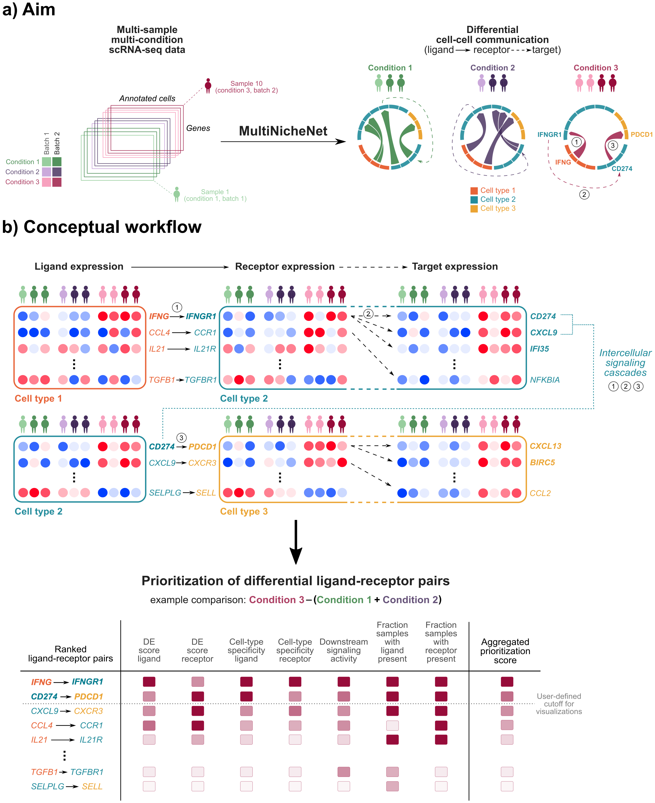

# MultiNicheNet 

<!-- badges: start -->
[](https://zaoqu-liu.r-universe.dev/multinichenetr)
[](https://github.com/Zaoqu-Liu/multinichenetr/actions)
[](https://github.com/Zaoqu-Liu/multinichenetr/issues)
[](https://github.com/Zaoqu-Liu/multinichenetr/stargazers)
[](https://opensource.org/licenses/MIT)
<!-- badges: end -->

## Overview

**MultiNicheNet** is a comprehensive computational framework for differential cell-cell communication (CCC) analysis in single-cell RNA sequencing (scRNA-seq) data with complex multi-sample, multi-condition experimental designs. This methodology enables systematic investigation of intercellular signaling differences across biological conditions, disease states, or treatment groups.

📖 **Citation**: Browaeys, R. et al. *MultiNicheNet: a flexible framework for differential cell-cell communication analysis from multi-sample multi-condition single-cell transcriptomics data*. bioRxiv (2023). [https://doi.org/10.1101/2023.06.13.544751](https://www.biorxiv.org/content/10.1101/2023.06.13.544751v1)

---

## Scientific Background

### Methodological Framework

MultiNicheNet extends the NicheNet ligand-target inference framework to accommodate multi-sample experimental designs through pseudobulk-based differential expression analysis. The core methodology integrates:

1. **Pseudobulk Aggregation**: Cell-level expression data is aggregated per sample to enable proper statistical inference at the sample level, avoiding inflated false discovery rates inherent to cell-level analyses.

2. **Differential Expression Analysis**: Leverages the [muscat](https://bioconductor.org/packages/release/bioc/html/muscat.html) framework for robust differential state analysis using mixed models or pseudobulk methods ([Crowell et al., Nat Commun 2020](https://doi.org/10.1038/s41467-020-19894-4)).

3. **Multi-Criteria Prioritization**: Integrates multiple biological criteria into a unified prioritization score:
   - Differential expression of ligands and receptors
   - Cell-type specificity of expression
   - Fraction of samples expressing the interaction
   - NicheNet ligand activity inference

4. **Downstream Target Prediction**: Identifies putative downstream signaling targets of prioritized ligand-receptor interactions using the NicheNet ligand-target prior knowledge model.

### Key Advantages

| Feature | Description |
|---------|-------------|
| **Multi-sample design** | Proper statistical inference at sample level using pseudobulk approaches |
| **Multi-condition support** | Flexible contrasts for complex experimental designs (≥2 conditions) |
| **Integrated prioritization** | Combines expression, specificity, and ligand activity metrics |
| **Extensible framework** | Supports integration of complementary data modalities (e.g., proteomics) |
| **Reproducibility** | Standardized workflow with comprehensive output documentation |

---

## Installation

### From R-Universe (Recommended)

```r
# Install from R-Universe
install.packages("multinichenetr", repos = "https://zaoqu-liu.r-universe.dev")
```

### From GitHub

```r
# Install dependencies
if (!require("BiocManager", quietly = TRUE))
    install.packages("BiocManager")
BiocManager::install(c("SingleCellExperiment", "muscat", "scuttle", "scran"))

# Install nichenetr dependency
if (!require("devtools", quietly = TRUE))
    install.packages("devtools")
    devtools::install_github("saeyslab/nichenetr")

# Install multinichenetr
devtools::install_github("Zaoqu-Liu/multinichenetr")
```

**System Requirements**: R ≥ 4.0.0. Tested on Windows, Linux (Ubuntu), and macOS.

---

## Quick Start

### Minimal Working Example

```r
library(multinichenetr)
library(SingleCellExperiment)

# Load example data
data(sce)

# Define analysis parameters
sample_id <- "tumor"
group_id <- "pEMT"
celltype_id <- "celltype"
contrasts_oi <- c("'High-Low'")
contrast_tbl <- tibble::tibble(contrast = "High-Low", group = "High")

# Load prior knowledge networks
lr_network <- readRDS(url("https://zenodo.org/record/5884439/files/lr_network_human_21122021.rds"))
ligand_target_matrix <- readRDS(url("https://zenodo.org/record/5884439/files/ligand_target_matrix_nsga2r_final.rds"))

# Run MultiNicheNet analysis
output <- multi_nichenet_analysis(
  sce = sce,
  celltype_id = celltype_id,
  sample_id = sample_id,
  group_id = group_id,
  lr_network = lr_network,
  ligand_target_matrix = ligand_target_matrix,
  contrasts_oi = contrasts_oi,
  contrast_tbl = contrast_tbl
)

# Access prioritized interactions
head(output$prioritization_tables$group_prioritization_tbl)
```

---

## Workflow Overview

```
┌─────────────────────────────────────────────────────────────────┐
│                    INPUT: SingleCellExperiment                  │
│              (raw counts + cell metadata)                       │
└─────────────────────────────────────────────────────────────────┘
                              │
                              ▼
┌─────────────────────────────────────────────────────────────────┐
│           Step 1: Gene Filtering & Expression Processing        │
│  • Filter lowly expressed genes                                 │
│  • Calculate expression fractions per sample/celltype           │
└─────────────────────────────────────────────────────────────────┘
                              │
                              ▼
┌─────────────────────────────────────────────────────────────────┐
│           Step 2: Pseudobulk Differential Expression            │
│  • Aggregate cells to pseudobulk per sample                     │
│  • Perform DE analysis using muscat framework                   │
│  • Calculate empirical p-values for robustness                  │
└─────────────────────────────────────────────────────────────────┘
                              │
                              ▼
┌─────────────────────────────────────────────────────────────────┐
│           Step 3: Ligand Activity Inference                     │
│  • Apply NicheNet to predict active ligands                     │
│  • Score ligand-receptor pairs by target gene enrichment        │
└─────────────────────────────────────────────────────────────────┘
                              │
                              ▼
┌─────────────────────────────────────────────────────────────────┐
│           Step 4: Multi-Criteria Prioritization                 │
│  • Integrate DE scores, expression, specificity                 │
│  • Calculate unified prioritization score                       │
│  • Rank ligand-receptor-sender-receiver combinations            │
└─────────────────────────────────────────────────────────────────┘
                              │
                              ▼
┌─────────────────────────────────────────────────────────────────┐
│                    OUTPUT: Prioritized CCC Events               │
│  • Ranked interaction tables                                    │
│  • Downstream target predictions                                │
│  • Visualization-ready data structures                          │
└─────────────────────────────────────────────────────────────────┘
```

---

## Documentation & Tutorials

### Comprehensive Tutorials

| Tutorial | Description | Link |
|----------|-------------|------|
| **Basic Analysis** | Complete walkthrough with 3-group comparison | [Markdown](vignettes/basic_analysis_steps_MISC.knit.md) |
| **Pairwise Comparison** | Two-condition analysis without repeated measures | [Markdown](vignettes/pairwise_analysis_MISC.knit.md) |
| **Paired Analysis** | Handling repeated subjects as covariates | [Markdown](vignettes/paired_analysis_SCC.knit.md) |
| **Batch Correction** | Atlas-scale data with batch effects | [Markdown](vignettes/batch_correction_analysis_LungAtlas.knit.md) |
| **Multifactorial Design** | Complex time × condition interactions | [Markdown](vignettes/multifactorial_analysis_BreastCancer.knit.md) |

### Advanced Topics

| Topic | Description | Link |
|-------|-------------|------|
| **Proteomics Integration** | Adding complementary data modalities | [Markdown](vignettes/add_proteomics_MISC.knit.md) |
| **Condition-Specific Cells** | Handling cell types present in subset of conditions | [Markdown](vignettes/condition_specific_celltype_MISC.knit.md) |
| **HPC Deployment** | Running on cluster infrastructure | [RMarkdown](vignettes/multinichenet_qsub.Rmd) |

### Parameter & Output Guides

- 📋 [Parameter Interpretation Guide](parameter_interpretation.pdf)
- 📊 [Output Figure Interpretation Guide](output_interpretation.pdf)

---

## Version 2.0.0 Updates (May 2024)

### Methodological Enhancements

- **Multi-modal data integration**: Framework for incorporating additional prioritization criteria from complementary data sources (e.g., serum proteomics)
- **Condition-specific cell type handling**: Alternative workflow for cell types present only in specific conditions
- **Enhanced regulatory network analysis**: Improved intercellular regulatory network construction for interaction pruning
- **OmniPath integration**: Quality assessment of ligand-receptor pairs based on database curation effort

### Technical Improvements

- Streamlined gene filtering parameters
- Option for up-regulatory ligand activity only
- Biological scenario-based prioritization (replacing manual weight tuning)
- Enhanced bubble plot visualizations with cell-type specificity and curation metrics

---

## Recommended Practices

### Sample Size Requirements

We recommend **≥4 samples per condition** for robust pseudobulk-based analysis. For datasets with fewer samples, consider the [sample-agnostic workflow](vignettes/basic_analysis_steps_MISC_SACL.knit.md), though results should be interpreted with appropriate caution.

### Input Data Requirements

- **Raw counts**: Unnormalized count matrix
- **Cell metadata**: Sample ID, condition/group, cell type annotations
- **Quality control**: Proper cell filtering, doublet removal, and ambient RNA correction should be performed prior to MultiNicheNet analysis

### Computational Resources

For large datasets (>100,000 cells, >10 cell types), we recommend:
- Running core analysis on HPC infrastructure
- Using the `make_lite_output()` function for portable results
- Performing visualization locally on the lite output object

---

## Citation

If you use MultiNicheNet in your research, please cite:

```bibtex
@article{browaeys2023multinichenet,
  title={MultiNicheNet: a flexible framework for differential cell-cell communication 
         analysis from multi-sample multi-condition single-cell transcriptomics data},
  author={Browaeys, Robin and others},
  journal={bioRxiv},
  year={2023},
  doi={10.1101/2023.06.13.544751}
}
```

### Related Publications

- **NicheNet**: Browaeys, R., Saelens, W. & Saeys, Y. *NicheNet: modeling intercellular communication by linking ligands to target genes*. Nat Methods 17, 159–162 (2020). [https://doi.org/10.1038/s41592-019-0667-5](https://doi.org/10.1038/s41592-019-0667-5)

- **muscat**: Crowell, H.L. et al. *muscat detects subpopulation-specific state transitions from multi-sample multi-condition single-cell transcriptomics data*. Nat Commun 11, 6077 (2020). [https://doi.org/10.1038/s41467-020-19894-4](https://doi.org/10.1038/s41467-020-19894-4)

---

## Support & Contributing

- 🐛 **Bug Reports**: [GitHub Issues](https://github.com/Zaoqu-Liu/multinichenetr/issues)
- 💬 **Questions**: [GitHub Discussions](https://github.com/Zaoqu-Liu/multinichenetr/discussions)
- 🤝 **Contributing**: Pull requests are welcome!

---

## License

This project is licensed under the MIT License - see the [LICENSE](LICENSE) file for details.

---

<p align="center">
  <i>Maintained by <a href="https://github.com/Zaoqu-Liu">Zaoqu Liu</a></i>
</p>
